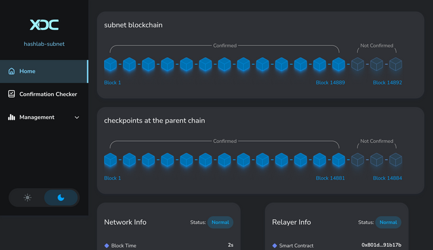
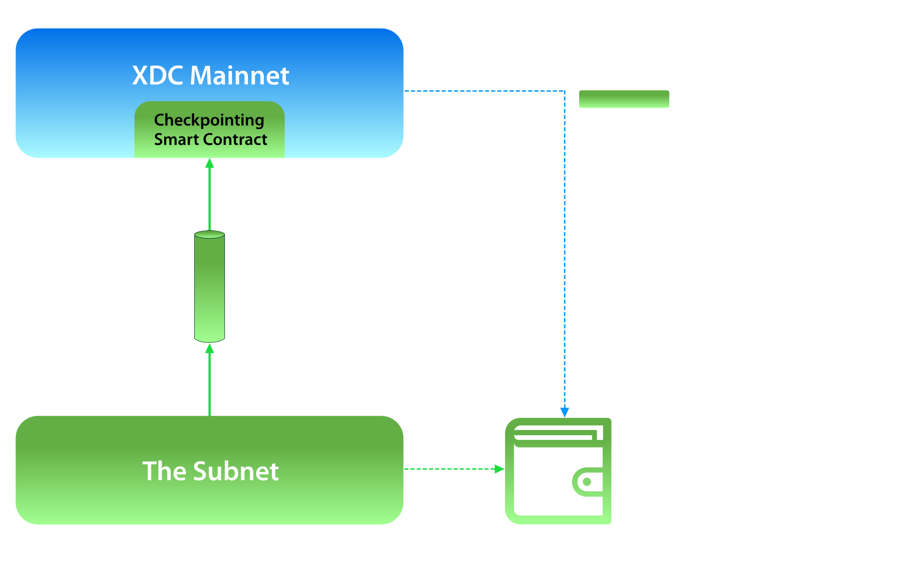

# XDC Subnet 

XDC Subnet enables organizations to deploy sovereign, permissioned blockchain networks that inherit the security, interoperability, and developer experience of the XDC Network while maintaining complete control over governance, privacy, infrastructure, and compliance.

Built on the XDC 2.0 consensus engine, Subnets are designed for enterprises, financial institutions, governments, and consortiums that require dedicated blockchain infrastructure without exposing sensitive transaction data on a public ledger.

Every subnet can be independently configured while securely checkpointing consensus data to the XDC Mainnet, providing additional security and auditability.

## Key Benefits

- Sovereign blockchain infrastructure
- Permissioned validator network
- Native EVM compatibility
- XDC Mainnet checkpointing
- Enterprise-grade privacy
- High throughput & low latency
- Independent governance
- Support for tokenization, RWAs and regulated finance
- Easy deployment using Deployment Wizard
- Compatible with XDC Explorer and developer tools

## Ideal Use Cases

XDC Subnets are suitable for:

* Central Bank Digital Currency (CBDC) pilots
* Government blockchain infrastructure
* Trade Finance
* Supply Chain Networks
* Cross-border settlement
* Asset Tokenization
* Real World Assets (RWAs)
* Enterprise Treasury
* Private DeFi
* Regulated Financial Markets
* Banking Consortiums
* Digital Identity
* Carbon Credit Platforms

## Why Choose XDC Subnet

XDC Subnet is purpose-built for enterprises, governments, and consortium networks that require privacy, regulatory compliance, and complete infrastructure control while maintaining interoperability with the XDC Network.

| Feature | XDC Subnet |
|---------|:----------:|
| Permissioned Network | ✅ |
| Private Transactions | ✅ |
| EVM Compatible | ✅ |
| XDC Mainnet Checkpointing | ✅ |
| Independent Validator Network | ✅ |
| Custom Governance | ✅ |
| Block Explorer Support | ✅ |
| Tokenization Ready | ✅ |
| Enterprise APIs | ✅ |

---

### Video Tutorial

📺 **XDC Subnet Setup Made EASY in 10 Minutes**

<iframe width="768" height="432" src="https://www.youtube.com/embed/-SXsRbn6hN8" title="Setting Up Your Own XDC-Subnet Tutorial" frameborder="0" allow="accelerometer; autoplay; clipboard-write; encrypted-media; gyroscope; picture-in-picture; web-share" referrerpolicy="strict-origin-when-cross-origin" allowfullscreen></iframe>

This official walkthrough covers:

- Environment setup
- Network configuration
- Validator deployment
- Block Explorer setup
- Faucet deployment
- Checkpoint smart contracts
- Running and managing your own XDC Subnet

---

## Institutional Ecosystem

XDC Network is supported by a growing ecosystem of institutional validators, infrastructure providers, financial institutions, and enterprise technology partners helping secure the network and accelerate real-world blockchain adoption.

### Institutional Validators

The XDC Network validator ecosystem includes globally recognized organizations such as:

| Organization | Industry |
|--------------|----------|
| Deutsche Telekom MMS | Telecommunications |
| SBI Holdings / SBI VC Trade | Financial Services |
| UOB Venture Management | Venture Capital |
| HashKey Cloud | Digital Asset Infrastructure |
| Republic | Private Markets & Tokenization |
| Animoca Brands | Web3 Investment |
| Clearpool | Institutional DeFi Credit |
| BCW Group | Enterprise Blockchain Infrastructure |
| stakeFi | Institutional Staking Infrastructure |
| SettleMint | Enterprise Blockchain Platform |
| IXS Finance | Regulated RWA Tokenization |
| InvestaX | Digital Securities & RWAs |
| RedStone | Oracle Infrastructure |
| Credora | Risk Intelligence |
| GSR | Digital Asset Market Maker |
| Blueprint | Institutional Infrastructure |
| Hivemind Digital Group | Digital Asset Investment |
| Ubyx | Stablecoin Infrastructure |

### Strategic Enterprise & Government Collaborations

Organizations across finance, trade, telecommunications, and government are leveraging or collaborating with the XDC ecosystem to modernize digital infrastructure.

- **Deutsche Telekom** – Institutional validator supporting network security.
- **Contour Network** – Digital trade finance network utilizing XDC technology for trade digitization.
- **SBI Group / SBI VC Trade** – Strategic ecosystem partner advancing blockchain innovation and enterprise adoption.
- **Zanzibar Government** – Partner in blockchain-enabled government and digital infrastructure initiatives.

> **Note:** The organizations listed above participate in the broader XDC ecosystem through validator operations, infrastructure, partnerships, or enterprise collaborations. Publicly available information does not necessarily indicate that every organization operates an XDC Subnet.

## Why XDC Subnets?

As a leading Layer-1 (L1) blockchain, the XDC Network is trusted by enterprises, financial institutions, governments, and industry consortiums building blockchain-powered digital infrastructure. While the XDC Network provides high performance, low transaction costs, and enterprise-grade security, many organizations also require dedicated infrastructure that meets strict privacy, governance, and regulatory requirements.

For these organizations, publishing business transactions directly to a public blockchain is often not an option. Sensitive financial, operational, or commercial data must remain confidential while still benefiting from the security, integrity, and interoperability of a public blockchain. XDC Subnets address this challenge by allowing organizations to operate private, permissioned blockchain networks while periodically checkpointing cryptographic proofs of their blockchain state to the XDC Mainnet.

### Why Subnets?

Several Layer-2 (L2) approaches exist for extending blockchain scalability and security, including optimistic rollups, zero-knowledge (ZK) rollups, and subnets.

- **Optimistic Rollups** improve scalability by executing transactions off-chain, but transaction data is still published to the Layer-1 network. This transparency is unsuitable for organizations requiring complete transaction privacy.
- **Zero-Knowledge (ZK) Rollups** preserve privacy through cryptographic proofs, but they remain computationally intensive and are currently best suited for specialized workloads such as token transfers and simple financial operations. Many enterprise applications require broader smart contract flexibility and lower operational complexity.

For enterprise and institutional deployments, **Subnets** provide a practical and flexible alternative.

Each XDC Subnet operates as an independent blockchain with its own validator network, governance model, and infrastructure. Rather than publishing every transaction to the public network, the subnet periodically checkpoints critical consensus data to the XDC Mainnet. This approach provides:

- Complete privacy for on-subnet transactions
- Independent governance and validator management
- Enterprise-grade resilience and availability
- Additional security through Mainnet checkpointing
- Seamless interoperability with the broader XDC ecosystem

Unlike public blockchain deployments, many enterprise customers prefer owning and operating their blockchain infrastructure within secure, isolated environments where they retain full control over infrastructure, compliance, and network policies. XDC Subnets are specifically designed to support this deployment model.

### Design Goals

The XDC Core Protocol team developed XDC Subnets to provide a purpose-built blockchain infrastructure for enterprise, government, and institutional applications. Key design objectives include:

- **Sovereign Infrastructure** – Deploy fully owned and independently governed permissioned blockchain networks.
- **Powered by XDC 2.0** – Built on the same high-performance consensus engine that secures the XDC Mainnet, delivering fast finality, security, and reliability.
- **Enhanced Security** – Combine the security of an independent validator network with optional checkpointing to the XDC Mainnet for additional integrity and auditability.
- **Native EVM Compatibility** – Deploy existing Ethereum smart contracts and developer tooling without modification.
- **Complete Transaction Privacy** – Business transactions remain private within the subnet and are never exposed on the public XDC Mainnet.
- **Enterprise Developer Experience** – Access the XDC ecosystem of SDKs, APIs, explorers, deployment tools, monitoring solutions, and developer resources.
- **Production-Ready Architecture** – Support real-world enterprise use cases including trade finance, asset tokenization, digital identity, supply chain, cross-border payments, government infrastructure, and regulated financial markets.

## Architecture
The architecture consists of the following key components owned by the customer:

- A subnet driven by the XDC2.0 consensus engine, with system configurations tailored for the customer
- A relayer program that checkpoint critical consensus data of the subnet to the XDC Mainnet
- A smart contract in the XDC Mainnet that verifies and records the checkpoints
- Wallet APIs that enable additional protection of subnet transaction from the XDC Mainnet
- The subnet will also natively support XDC's abundant utility tools such as blockchain explorer and forensic monitor

The subnet architecture combines a sovereign permissioned blockchain, a relayer service, checkpoint smart contracts on XDC Mainnet, wallet APIs, and native developer tooling to deliver secure enterprise blockchain infrastructure.

    <a href="../components/subnet_chain/" class="grid-item">
        
Components

        
Continue reading on individual components of the Subnet architecture

    </a>
    <a href="../install_guide/launch_subnet/" class="grid-item">
        
Launch a Subnet in 10 Minutes

        
Start your own Subnet with our intuitive and easy to use Deployment Wizard

    </a>

