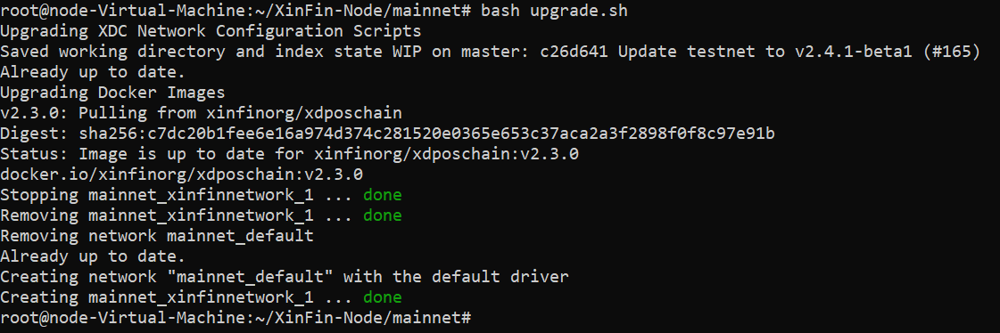

# Setup XDC Masternode using Docker

## Setting up XDC Network Masternode Docker version

The server or VPS used for the masternode should be directly facing the internet with a public IP and without NAT. 


**Operating System**: Ubuntu 20.04 64-bit or higher

Should be facing internet directly with **public IP** & **without NAT**

**Tools**: Docker, Docker Compose(1.27.4+)

Setup (For Ubuntu 20.04 64-bit or higher Operating System)

Follow the written steps starting from step 1, or you can watch the video tutorials:

<iframe width="768" height="432" src="https://www.youtube.com/embed/1A20eVTJYvs" title="Deploying an XDC Network Masternode via Docker" frameborder="0" allow="accelerometer; autoplay; clipboard-write; encrypted-media; gyroscope; picture-in-picture; web-share" referrerpolicy="strict-origin-when-cross-origin" allowfullscreen></iframe>

## Step 1: Clone repository
```bash
git clone https://github.com/XinFinOrg/XinFin-Node.git

```

## Step 2: Change directory
Then we change the directory to XinFin-Node
```bash
cd XinFin-Node
```

## Step 3: Install docker
We need to install Docker and Docker-Compose by running the following command:
```bash
sudo ./setup/install_docker.sh
```

## Step 4: 
Create a new .env file and copy the env.example file that exist in the mainnet directory. We will ensure we are in the "mainnet" directory by typing these commands. Once in edit mode for the .env file, name your masternode and use an email address in the respective fields
```bash
cd mainnet
cp env.example .env
nano .env 

```
**For Testnet**
```bash
cd testnet
cp env.example .env
nano .env
```

## Step 5: Start your Node
**For Mainnet run the following commands:**
```bash
cd mainnet
bash docker-up.sh
```
At this point you should be able to see your masternode on the list of nodes here or as shown below:


For Testnet run the following commands:
```bash
cd testnet
bash docker-up.sh
```
You should be able to see your node listed on the [Apothem Network] page. Select **"Switch to LiveNet"** to check **LiveNetwork** Stats and Select **"Switch to TestNet"** for **TestNetwork**.

Your coinbase address can be found in xdcchain/coinbase.txt file.

For troubleshooting purposes, you can stop the node by using the following command on either Mainnet or Testnet:
```bash
bash docker-down.sh
```

**Downloading a Network Snapshot (Mainnet or Apothem)**

The following steps are to expedite the syncing process of your node with the XDC Network.  If you followed the steps above, your node will take 3-4 days to sync up with the network fully.  You can reduce that time by downloading a network snapshot and bringing your node back up after the chain has been downloaded and unpacked. 

<iframe width="768" height="432" src="https://www.youtube.com/embed/ZQF3f0Zd6-k" title="Downloading an XDC Network Snapshot to Expedite Node Syncing to" frameborder="0" allow="accelerometer; autoplay; clipboard-write; encrypted-media; gyroscope; picture-in-picture; web-share" referrerpolicy="strict-origin-when-cross-origin" allowfullscreen></iframe>

**Option A: One-command downloader (recommended)**

The official downloader asks you to choose the network (Mainnet or Testnet/Apothem) and node type (Full or Archive). It resumes automatically if the connection drops. Snapshot files are very large (400 GB to 2 TB+), so run it inside `tmux` or `screen`:
```bash
sudo apt install -y tmux lz4
tmux new -s download
curl -fsSL https://rpc.xdc.network/download | bash
```
To detach and leave the download running, press `Ctrl+B`, then `D`. To reattach later, run `tmux attach -t download`.

Note: the downloader sends download statistics (start, completion or failure event, network, node type, download method, duration, size, speed and error code) to `https://rpc.xdc.network/telemetry`. Like any web request, this also exposes your server's IP address. If you prefer not to send them, use Option B.

All available snapshots, with their block height and size, are listed at [https://rpc.xdc.network/snapshots](https://rpc.xdc.network/snapshots).

**Option B: Manual download**

# Mainnet Snapshot

**Bring down your node:**
```bash
bash docker-down.sh
```
**Remove any old snapshot file from the server**
```bash
rm -f mainnet_full_latest.tar.lz4 mainnet_archive_latest.tar.lz4
```
**Download the snapshot** 

Full Node snapshot: 
```bash
wget -c https://rpc.xdc.network/snapshots/mainnet/full/mainnet_full_latest.tar.lz4
```

Archive Node snapshot: 
```bash
wget -c https://rpc.xdc.network/snapshots/mainnet/archive/mainnet_archive_latest.tar.lz4
```
If the download is interrupted, run the same `wget -c` command again to resume it.

**Unpack the snapshot file** (requires `lz4`; for an Archive Node, use `mainnet_archive_latest.tar.lz4`)
```bash
sudo apt install -y lz4
lz4 -d -c mainnet_full_latest.tar.lz4 | tar -xvf -
```
**The unpacking will take some time. It creates an `XDC` directory and lists files like this:**
```
XDC/
XDC/chaindata/
XDC/chaindata/2359986.ldb
...
```

**The following command will move the xdcchain/XDC to xdcchain/XDC_backup**
```bash
mv  xdcchain/XDC xdcchain/XDC_backup
mv XDC xdcchain
```

**Then we are going to remove the old "nodekey" file**
```bash
rm -rf xdcchain/XDC/nodekey
```

**The last step is to run the bash upgrade.sh command**
```bash
bash upgrade.sh
```

This command will bring your node up and it will start syncing to the network. Once up and running, your node will be synced to the network in just a few minutes. 



# Apothem Snapshot

**Bring down your node:** 
```bash
bash docker-down.sh
```

**Remove any old snapshot file from the server**
```bash
rm -f testnet_full_latest.tar.lz4 testnet_archive_latest.tar.lz4
```

**Download the snapshot**

Full Node snapshot: 
```bash
wget -c https://rpc.xdc.network/snapshots/testnet/full/testnet_full_latest.tar.lz4
```

Archive Node snapshot: 
```bash
wget -c https://rpc.xdc.network/snapshots/testnet/archive/testnet_archive_latest.tar.lz4
```

**Unpack the snapshot file** (requires `lz4`; for an Archive Node, use `testnet_archive_latest.tar.lz4`)
```bash
sudo apt install -y lz4
lz4 -d -c testnet_full_latest.tar.lz4 | tar -xvf -
```

**Back up the old chain data and move the new `XDC` directory into xdcchain-testnet**
```bash
mv xdcchain-testnet/XDC xdcchain-testnet/XDC_backup
mv XDC xdcchain-testnet
rm -rf xdcchain-testnet/XDC/nodekey
```

**Bring up the node**
```bash
bash docker-up.sh
```


